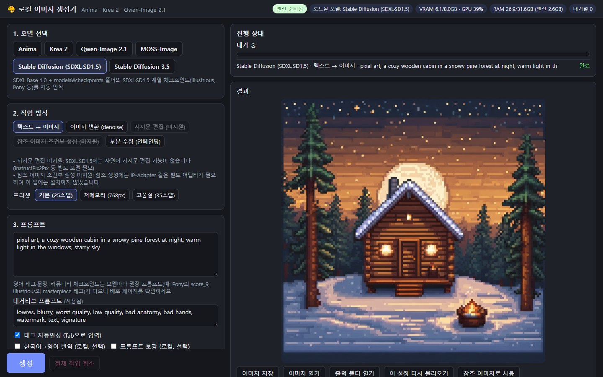
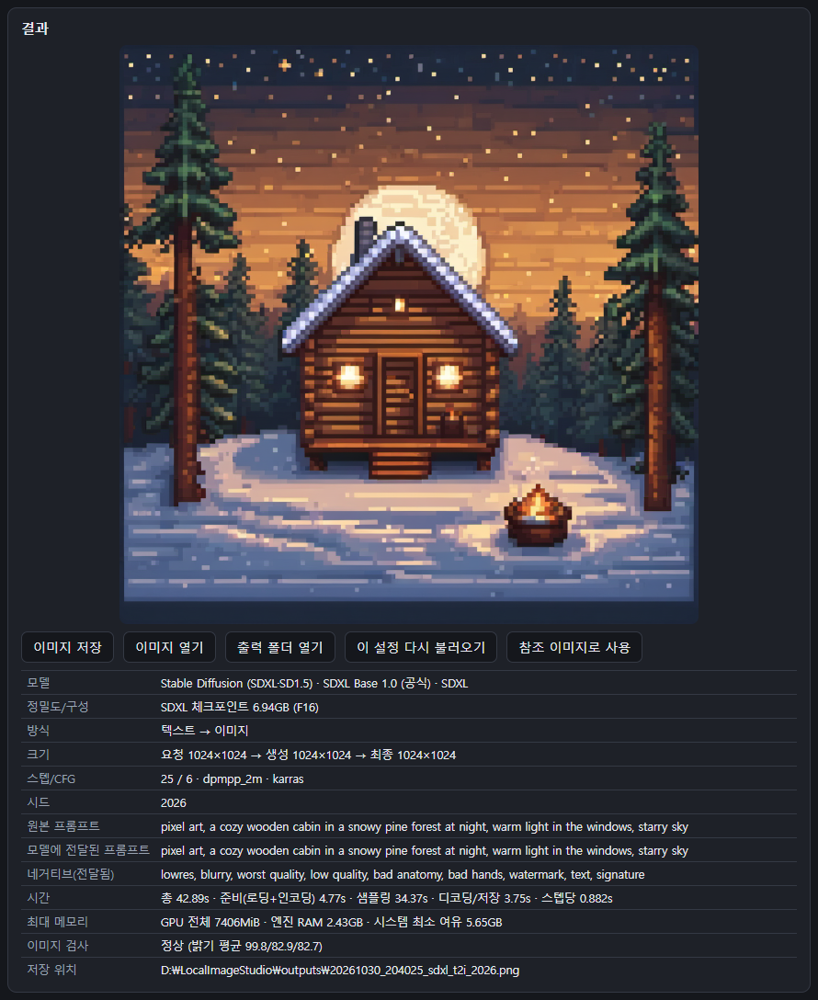
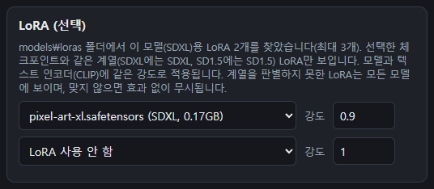
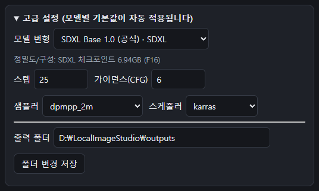

# LocalImageStudio — 로컬 이미지 생성기

Anima · Krea 2 · Qwen-Image 2.1 · MOSS-Image · Stable Diffusion(SDXL/SD1.5/SD 3.5)을 **내 PC에서만** 실행하는 한국어 GUI 이미지 생성 프로그램입니다.
프롬프트와 이미지는 인터넷으로 전송되지 않습니다(접속 주소 `127.0.0.1`, 이 PC 전용). 설치할 때만 프로그램과 모델 파일을 내려받습니다.



- 버전: 1.3.0 ([VERSION.txt](../배포/LocalImageStudio/VERSION.txt))
- 생성 엔진: ComfyUI v0.43.0 · Python 3.13.15 · PyTorch 2.14.1+cu130

## 주요 기능

- **텍스트 → 이미지**, **이미지 변환**(denoise), **지시문 편집**(Qwen, "우산을 파란색으로 바꿔 줘"), **참조 이미지 생성**(Krea 2 화풍 참조 · Qwen 다중 참조), **부분 수정(인페인팅)**(SD 계열)
- 모든 모델에서 **LoRA** 최대 3개 사용. 파일 내용으로 계열을 판별해 맞는 모델에만 표시
- 직접 받은 SDXL·SD1.5 체크포인트(Illustrious·Pony 포함) 자동 인식
- 한국어→영어 프롬프트 번역·보강(로컬 실행), Danbooru **태그 자동완성**(영어·한국어 별칭)
- 쇼츠 9:16(1080×1920) 프리셋, 연속 생성 대기열, 생성 기록, 엔진 상태·VRAM 표시

## 필요한 환경

| 항목 | 요구 사항 |
|---|---|
| OS | Windows 10/11 64비트 |
| GPU | NVIDIA, VRAM 8GB 이상 권장, CUDA 13.0 이상을 지원하는 최신 드라이버 (AMD·Intel·Mac 미지원) |
| RAM | 16GB 이상 (Krea 2는 32GB 권장) |
| 디스크 | 프로그램 약 8GB + 고른 모델 (SSD 권장) |

모델별 용량: Anima 약 9.8GB · Krea 2 약 19.5GB · Qwen-Image 2.1 약 17.3GB · Qwen Base(선택) 약 7.3GB · SDXL 약 7.0GB · SD 3.5 Medium 약 11.6GB · SD 3.5 Large 약 14.9GB · MOSS-Image 약 13.0GB

## 설치

1. 이 저장소의 [`배포/LocalImageStudio`](../배포/LocalImageStudio) 폴더를 받습니다(Releases의 zip 또는 저장소 다운로드). 공간이 넉넉한 드라이브에 둡니다(예: `D:\LocalImageStudio`).
2. 폴더 안의 **`설치.bat`** 을 실행합니다. "Windows의 PC 보호" 창이 뜨면 `추가 정보` → `실행`.
3. 설치할 모델 번호를 고르고(엔터 = 1,2,3 / `all` = 전부) 라이선스 안내를 확인한 뒤 `y`를 입력합니다.
4. 다운로드는 30분~수 시간 걸립니다. 중간에 끊겨도 `설치.bat`을 다시 실행하면 이어받습니다.
5. 끝나면 바탕화면에 **`로컬 이미지 생성기`** 바로가기가 생깁니다.

Python·가상환경·ComfyUI·모델은 모두 이 폴더 안에 설치되며, 시스템 Python이나 다른 AI 프로그램에는 영향을 주지 않습니다.
이미 받은 모델은 SHA256만 확인하고 건너뛰며, PC 안의 다른 ComfyUI 설치·Hugging Face 캐시에 같은 파일이 있으면 찾아서 재사용합니다.

### 이전 버전에서 업데이트

1. 바탕화면 `로컬 이미지 생성기 - 종료·복구`로 프로그램을 끕니다.
2. 새 파일을 기존 설치 폴더에 덮어씁니다.
3. `설치.bat`을 다시 실행합니다. ComfyUI가 오래되었으면 자동으로 교체하며, 모델(`models\`)·생성 이미지(`outputs\`)·기록·설정(`app\data\`)은 그대로 둡니다.

## 실행

- 바탕화면 `로컬 이미지 생성기` (또는 `이미지생성기_실행.bat`)
- 약 20초 뒤 브라우저에 `http://127.0.0.1:7860/` 화면이 열립니다. 콘솔 창을 닫으면 종료됩니다.
- 멈췄을 때: 바탕화면 `로컬 이미지 생성기 - 종료·복구` 실행 후 다시 실행

## 사용법

화면 왼쪽에서 위부터 차례로 고르고 **생성**(Ctrl+Enter)을 누르면, 오른쪽에 진행 상태와 결과가 나타납니다.

1. **모델 선택** — 용도에 맞게 고릅니다. 설치하지 않은 모델은 "(미설치)"로 표시됩니다.

   | 모델 | 잘하는 것 |
   |---|---|
   | Anima | 애니메이션·일러스트 (Danbooru 태그 + 영어 문장) |
   | Krea 2 | 미적 품질이 높은 범용·사진풍 |
   | Qwen-Image 2.1 | 이미지 속 글자, 지시문 편집("우산을 파란색으로"), 여러 장 참조 |
   | MOSS-Image | 긴 영어 묘사, 글자 표현 |
   | Stable Diffusion | SDXL Base + 직접 받은 SDXL·SD1.5 체크포인트, SD 3.5, 부분 수정(인페인팅) |

2. **작업 방식** — `텍스트 → 이미지`, `이미지 변환`, `지시문 편집`, `참조 이미지 조건부 생성`, `부분 수정(인페인팅)`. 지금 모델이 지원하지 않는 방식은 줄이 그어지고 이유가 표시됩니다.
   **프리셋**은 `기본` / `저메모리` / `고품질` 중에서 고릅니다. 느리거나 메모리가 부족하면 `저메모리`를 쓰세요.
3. **프롬프트** — 만들 그림을 영어로 쓰는 것이 가장 정확합니다. 한국어로 쓰려면 `한국어→영어 번역`을 켜세요(PC 안에서 번역).
   입력 중에는 Danbooru 태그 자동완성이 뜹니다(↑↓로 고르고 Tab·Enter로 입력). 네거티브 프롬프트는 지원하는 모델에서만 켜집니다.
4. **LoRA (선택)** — 아래 [LoRA 추가하기](#lora-추가하기)를 참고하세요.
5. **참조 이미지** — 이미지 변환·편집·참조·인페인팅에서 씁니다. 칸을 클릭해 파일을 고르거나, 끌어다 놓거나, PC 경로를 붙여 넣으세요.
6. **크기·시드** — `정사각형` / `가로형 16:9` / `쇼츠 9:16`(1080×1920으로 저장). 같은 그림을 다시 만들려면 `매번 랜덤`을 끄고 시드를 고정합니다. `연속 생성`으로 최대 8장까지 대기열에 넣습니다.
7. **생성** — 오른쪽에 진행 단계와 결과가 표시됩니다.



결과 아래 버튼:

| 버튼 | 하는 일 |
|---|---|
| 이미지 저장 | 브라우저 다운로드 폴더로 한 장 더 저장 (원본은 이미 출력 폴더에 저장돼 있음) |
| 이미지 열기 / 출력 폴더 열기 | 기본 이미지 뷰어 / 탐색기로 열기 |
| 이 설정 다시 불러오기 | 모델·프롬프트·LoRA·시드 등을 그대로 화면에 다시 채움 |
| 참조 이미지로 사용 | 이 결과를 다음 작업의 입력 이미지로 넣음 |

오른쪽 아래 **생성 기록**에서 지난 결과를 클릭하면 다시 볼 수 있고, ✕나 체크박스로 기록을 지울 수 있습니다.
`이미지 파일도 휴지통으로 이동`을 켜고 지우면 이미지 파일도 Windows 휴지통으로 옮겨집니다(끄면 기록만 지움).

## LoRA 추가하기

1. Civitai·Hugging Face 등에서 LoRA 파일(`.safetensors`)을 받습니다.
2. 설치 폴더의 **`models\loras`** 폴더에 넣습니다. 모든 모델의 LoRA를 같은 폴더에 넣으면 됩니다.
3. 앱 화면을 **새로고침**(F5)합니다. 프로그램을 다시 시작할 필요는 없습니다.
4. 모델을 고르면 `LoRA (선택)` 칸에 **그 모델에 맞는 LoRA만** 나타납니다. 최대 3개까지 고르고 각각 강도(-2 ~ 2, 보통 0.6~1.0)를 정합니다.



- 앱이 파일 내용을 읽어 어느 모델용인지 자동으로 판별합니다. 예를 들어 SDXL에는 SDXL LoRA만, Krea 2에는 Krea 2 LoRA만 보입니다. 판별하지 못한 파일은 모든 모델에 보이지만, 맞지 않는 모델에서는 효과가 없습니다.
- 사용할 수 있는 LoRA: Anima · Krea 2 · Qwen-Image 2.1 · MOSS-Image · SDXL · SD1.5 · SD 3.5용
- 사용할 수 없는 LoRA: Flux.1용, Qwen-Image 1.x(20B)용. SD 3.5 Medium용과 Large용은 서로 호환되지 않습니다.
- LoRA를 받은 페이지에 적힌 **트리거 단어**(예: `pixel art`)가 있으면 프롬프트에 함께 넣으세요.

### 직접 받은 체크포인트 쓰기

SDXL·SD1.5 계열 체크포인트(Illustrious·Pony 포함, `.safetensors`)는 **`models\checkpoints`** 폴더에 넣고 새로고침합니다.
`Stable Diffusion (SDXL·SD1.5)`을 고른 뒤 `고급 설정 → 모델 변형` 목록에서 고르면 됩니다. SD2.x·Flux 등 다른 구조는 지원하지 않습니다.

## 이미지가 저장되는 곳

생성한 이미지는 자동으로 저장됩니다. 기본 위치는 **`<설치 폴더>\outputs`** 입니다(예: `D:\LocalImageStudio\outputs`).

| 위치 | 내용 |
|---|---|
| `outputs\` | 결과 이미지. 파일명 `날짜_시간_모델_방식_시드.png` (예: `20261030_204025_sdxl_t2i_2026.png`) |
| `outputs\입력_이미지\` | 작업에 사용한 참조 이미지 사본 |
| `outputs\원본_생성크기\` | 최종 크기와 생성 크기가 다를 때(쇼츠 등) 리사이즈 전 원본 |
| `app\data\history.jsonl` | 생성 기록 |
| `app\data\settings.json` | 화면 설정 |
| `logs\` | 실행 기록(`comfyui.log`, `app_events.jsonl`) |

- 각 PNG 안에는 생성 설정(모델·프롬프트·시드 등)이 함께 기록됩니다.
- 저장 위치를 바꾸려면 `고급 설정` → **출력 폴더**에 경로를 넣고 `폴더 변경 저장`을 누르세요.
- 결과 화면의 `출력 폴더 열기`를 누르면 탐색기에서 바로 열립니다.



> 스크린샷의 `D:\LocalImageStudio`는 설치 위치 예시입니다. 실제로는 압축을 푼 폴더 경로가 표시됩니다.

## 문서

| 문서 | 내용 |
|---|---|
| [처음_읽어주세요.txt](../배포/LocalImageStudio/처음_읽어주세요.txt) | 설치·업데이트·라이선스 요약 |
| [docs/사용설명서.md](../배포/LocalImageStudio/docs/사용설명서.md) | 화면 사용법, 저장 위치, 권장 사용법, 문제 해결 |
| [docs/모델_구성.md](../배포/LocalImageStudio/docs/모델_구성.md) | 모델 버전·정밀도·워크플로·메모리 설정·라이선스 |
| [docs/workflows/](../배포/LocalImageStudio/docs/workflows) | 모델·모드별 ComfyUI API 워크플로 |

## 폴더 구성

```
LocalImageStudio/
├─ 설치.bat                  설치·모델 추가·업데이트
├─ 이미지생성기_실행.bat      실행
├─ 이미지생성기_복구.bat      종료·복구
├─ app/                      프로그램 소스 (서버·GUI·태그 데이터)
├─ setup/                    설치 프로그램 (bootstrap.ps1, setup.py, 패키지 버전 고정)
└─ docs/                     설명서·워크플로
```

설치하면 `python\`, `venv\`, `ComfyUI\`, `models\`, `outputs\`, `logs\` 폴더가 함께 생깁니다(저장소에는 포함되지 않음).

## 라이선스

- **이 프로그램 코드**: [MIT License](../LICENSE)
- **ComfyUI**: GPL-3.0 (설치 때 공식 GitHub에서 내려받음)
- **태그 데이터** (`app/data/tags/`): 한국어 현지화 부분 CC BY-SA 4.0, 원본 MIT — [LICENSE.txt](../배포/LocalImageStudio/app/data/tags/LICENSE.txt)
- **모델** (설치 때 각 공식 배포처에서 내려받음, 저장소에는 포함되지 않음):

| 모델 | 라이선스 | 요약 |
|---|---|---|
| Anima | CircleStone Labs Non-Commercial License | 모델은 비상업 용도만 |
| Krea 2 | Krea 2 Community License | 연매출 100만 달러 미만 상업 사용 가능. 부적절한 결과물을 거르는 조치(직접 검토 등) 필요 |
| Qwen-Image 2.1 | Qwen Research License | 연구·비상업 용도만 |
| MOSS-Image | Apache-2.0 | 상업 사용 가능 |
| Stable Diffusion XL | CreativeML Open RAIL++-M | 상업 사용 가능, 이용 제한 조항 준수 |
| Stable Diffusion 3.5 | Stability AI Community License | 연매출 100만 달러 미만 상업 사용 가능 |

직접 넣은 체크포인트·LoRA는 각 배포처의 라이선스를 따릅니다. 생성한 이미지의 사용 책임은 사용자에게 있습니다. (법률 자문 아님)
